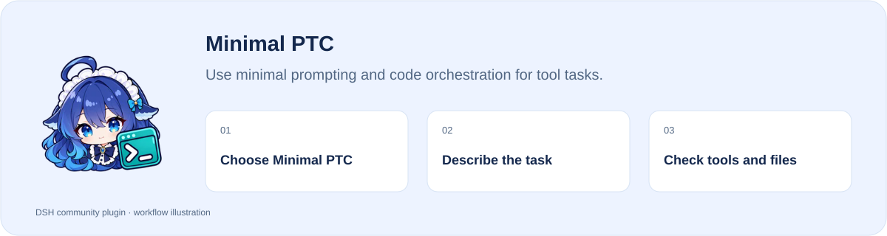

[简体中文](README.md) · **English**

# Minimal PTC

> **Run multi-step tool tasks with minimal prompting and clean code orchestration.**

Minimal PTC session preset plugin for DeepSeek Harness (`>=0.2.2-rc.3`): pairs a lean system prompt with Python/TypeScript `run_code` orchestration while preserving host safety and subagent constraints.

[](https://www.npmjs.com/package/dsh-minimal-ptc) [](https://www.npmjs.com/package/dsh-minimal-ptc) [](https://www.npmjs.com/package/dsh-minimal-ptc)

**[Features](#features) · [Install](#install) · [Workflow](#start-using-it) · [Full Guide](https://github.com/STARDUSTLC666/dsh-minimal-ptc/blob/main/docs/REFERENCE.en.md)**

<picture>
  <source media="(prefers-color-scheme: dark) and (max-width: 640px)" srcset="https://raw.githubusercontent.com/STARDUSTLC666/dsh-minimal-ptc/main/docs/assets/intro/workflow-en-mobile-dark.svg">
  <source media="(max-width: 640px)" srcset="https://raw.githubusercontent.com/STARDUSTLC666/dsh-minimal-ptc/main/docs/assets/intro/workflow-en-mobile-light.svg">
  <source media="(prefers-color-scheme: dark)" srcset="https://raw.githubusercontent.com/STARDUSTLC666/dsh-minimal-ptc/main/docs/assets/intro/workflow-en-dark.svg">
  
</picture>

<a id="what-it-does"></a>
## Features

| Capability | What It Gives You |
| :--- | :--- |
| **Standalone Lean Preset** | Pick **Minimal PTC mode** directly in the DSH session mode selector to cut prompt overhead |
| **Official `run_code` Orchestration** | Chain multi-step tool calls cleanly in TypeScript or Python for batching and data transforms |
| **Host Guardrails Preserved** | Inherits DSH execution mode, permission approvals, and subagent boundaries without bypassing rules |
| **Windows Terminal Ready** | Tuned for Windows Git Bash and persistent PowerShell sessions out of the box |

## Install

Open **Plugins** in the DSH desktop app and install `dsh-minimal-ptc`, or use the CLI:

```bash
dsh plugin --profile desktop add dsh-minimal-ptc
```

For the web profile, replace `desktop` with `web`. Restart that DSH profile after installation. Requires DSH `>=0.2.2-rc.3`.

## Start using it

1. Install in the DSH profile you use, restart it, and create a new session.
2. Select **Minimal PTC mode** in the session mode selector.
3. Describe the task and target workspace; the assistant orchestrates tools via TypeScript/Python (ensure the chosen runtime is installed).
4. Review tool outputs and changed files. Switch session modes anytime—installing the full Suite is optional.

### Ready-to-copy prompt

> Complete the task in this workspace. Check available tools and runtimes first and follow the current mode's rules.

## Before you start

- This plugin is a **session preset**: required language runtimes and individual tool dependencies must still be available locally.
- See [Executor compatibility](docs/WORKBENCH.md) for the `alpha.3` native executor and legacy-host fallback, and [Full reference](https://github.com/STARDUSTLC666/dsh-minimal-ptc/blob/main/docs/REFERENCE.en.md) for configuration and limits.

## Plugin updates

Check updates at the bottom of native plugin details. Automatic checks are on by default; **automatic installation is off**. Suite-managed components update with their bundle. [Update behavior](https://github.com/STARDUSTLC666/dsh-minimal-ptc/blob/main/docs/REFERENCE.en.md).

## Documentation & Feedback

- [Full usage, config & limits](https://github.com/STARDUSTLC666/dsh-minimal-ptc/blob/main/docs/REFERENCE.en.md) · [Executor compatibility](docs/WORKBENCH.md) · [Release notes](https://github.com/STARDUSTLC666/dsh-minimal-ptc/blob/main/CHANGELOG.md) · [Validation](https://github.com/STARDUSTLC666/dsh-minimal-ptc/blob/main/docs/VALIDATION.md)
- If this plugin helps, consider starring the repo. Report problems in [Issues](https://github.com/STARDUSTLC666/dsh-minimal-ptc/issues) or submit [PRs](https://github.com/STARDUSTLC666/dsh-minimal-ptc/pulls) (include versions/steps and strip credentials).

## License

[MIT](https://github.com/STARDUSTLC666/dsh-minimal-ptc/blob/main/LICENSE)

<a id="requirements-and-configuration"></a>
